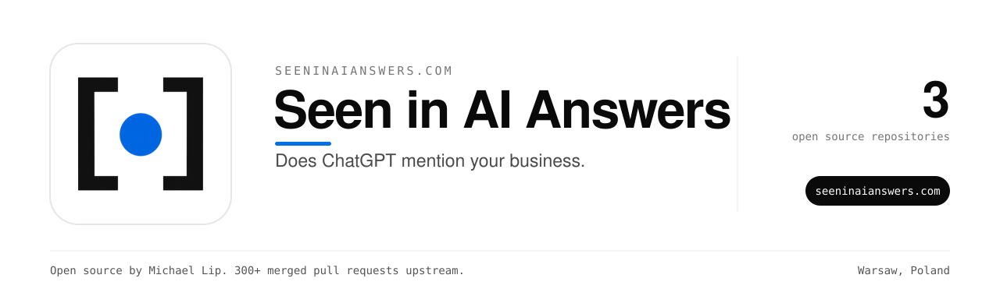

AI visibility snapshots. See if ChatGPT, Perplexity and Google AI Overviews mention your business.

Use it at [seeninaianswers.com](https://seeninaianswers.com).

### Repositories

| Repository | What it does |
| --- | --- |
| [ai-answer-citations](https://github.com/seeninaianswers/ai-answer-citations) | Extract the cited sources from an AI answer and tally them per host |
| [ai-mention-rs](https://github.com/seeninaianswers/ai-mention-rs) | Rust crate ai-mention-rs |

### Maintainer

Built and maintained by [Michael Lip](https://github.com/theluckystrike) in Warsaw, Poland.
He also fixes bugs in projects he uses. He has 300+ merged pull requests in 200+ outside repositories, including [urllib3](https://github.com/urllib3/urllib3/pull/5330), [Appium](https://github.com/appium/appium/pull/22911), [Prefect](https://github.com/PrefectHQ/prefect/pull/21916) and [Google Chrome extension samples](https://github.com/GoogleChrome/chrome-extensions-samples/pull/1629).
Need an engineer for your own product or AI agent? Send a written brief at [axdale.com](https://www.axdale.com/?utm_source=github&utm_medium=org&utm_campaign=hire&utm_content=seeninaianswers).
